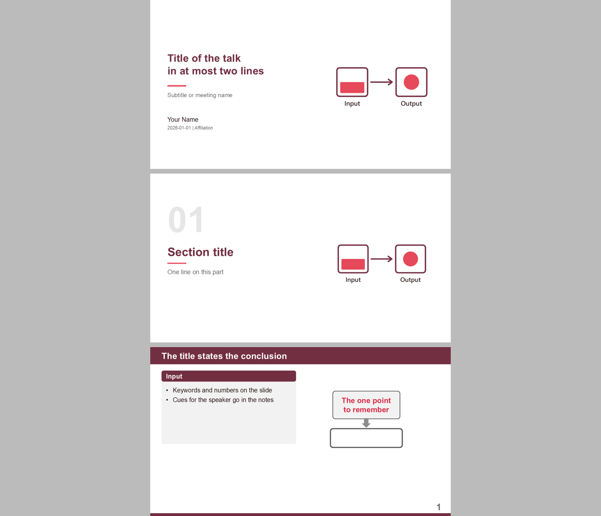
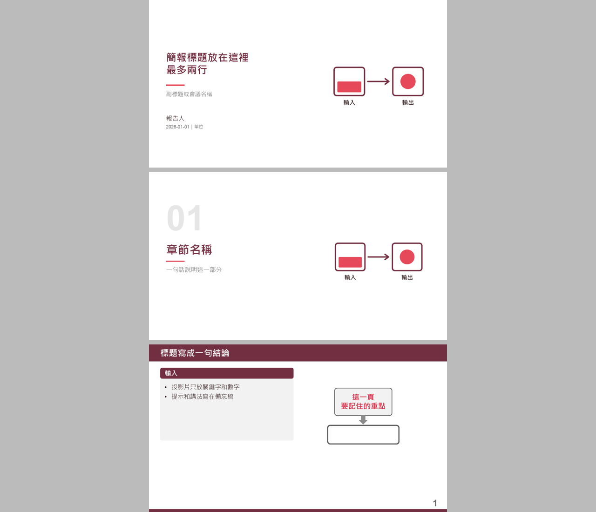

# academic-slide-style

A Claude skill for academic talks in English or Traditional Chinese: burgundy title bar, bright-red and grey emphasis, a thin bottom line with a large page number, a cover schematic drawn from the talk's own content, and short cue notes for presenter view.

Claude 學術簡報 skill，支援英文和繁體中文：酒紅標題列、亮紅與灰階強調、底部細線配大頁碼、依簡報內容設計的封面示意圖，以及適合簡報者畫面的摘要式備忘稿。

| English | 繁體中文 |
|---|---|
|  |  |

## Install / 安裝

Copy this folder to `~/.claude/skills/academic-slide-style`. Requires `python-pptx`, `pillow` and `matplotlib`.

把這個資料夾複製到 `~/.claude/skills/academic-slide-style`。需要 `python-pptx`、`pillow`、`matplotlib`。

```bash
python scripts/sample_deck.py en
python scripts/sample_deck.py zh
```

## Credits and licence / 來源與授權

MIT, see [LICENSE](LICENSE). `scripts/slide_kit.py` is adapted from [paper-sharing-skills](https://github.com/Ashur5457/paper-sharing-skills) by whats2000, MIT, see [LICENSE-slide_kit](LICENSE-slide_kit). The layout builds on the workflow of its `paper-discussion-slides` skill.
